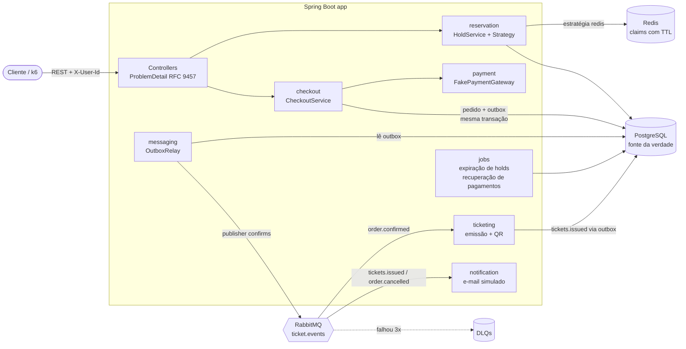
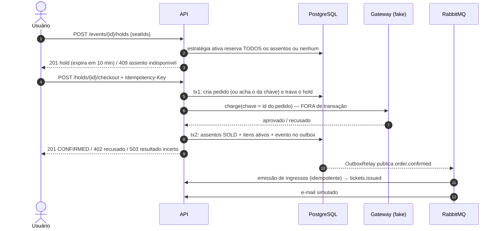

# Ticket System — venda de ingressos com alta concorrência

[](https://github.com/Thg1zZ/TicketSystem/actions/workflows/ci.yml)

API backend para a **abertura de vendas de um show**: milhares de pessoas tentando comprar os mesmos
assentos no mesmo segundo. O sistema tem duas regras inegociáveis:

1. **nunca vender o mesmo assento duas vezes;**
2. **nunca cobrar o mesmo pagamento duas vezes.**

O diferencial do projeto é **implementar quatro estratégias de controle de concorrência, trocáveis por
configuração, e compará-las com teste de carga (k6)** — com prova, via SQL, de zero vendas duplicadas.

> Java 21 · Spring Boot 4.1 · PostgreSQL 17 + Flyway · Redis 8 · RabbitMQ 4 · Testcontainers · k6 · Docker Compose

---

## Sumário
- [Arquitetura](#arquitetura)
- [Fluxo de compra](#fluxo-de-compra)
- [Estratégias de concorrência](#estratégias-de-concorrência)
- [Resultados do teste de carga](#resultados-do-teste-de-carga)
- [Como as garantias são asseguradas](#como-as-garantias-são-asseguradas)
- [Segurança](#segurança)
- [Decisões técnicas](#decisões-técnicas)
- [API](#api)
- [Como rodar](#como-rodar)
- [Testes](#testes)
- [Limitações conhecidas e próximos passos](#limitações-conhecidas-e-próximos-passos)

---

## Arquitetura



Código organizado **por feature** (`event`, `reservation`, `checkout`, `payment`, `ticketing`, `notification`,
`messaging`, `shared`), não por camada.

## Fluxo de compra



## Estratégias de concorrência

Selecionadas por `ticket.reservation.strategy` (no Docker: `STRATEGY=redis docker compose up -d`).
Todas passam pelo **mesmo contrato de testes** (`ReservationStrategyContract`): 50 threads no mesmo assento →
exatamente 1 vencedor; pedidos sobrepostos em ordem invertida → sem deadlock; hold expirado pode ser tomado;
hold liberado pode ser reservado na hora.

| Estratégia | Como funciona | A favor | Contra |
|---|---|---|---|
| `pessimistic` (padrão) | `SELECT … FOR UPDATE OF s ORDER BY id`: trava as linhas dos assentos | Simples, correto por construção | Quem chega depois **espera** segurando conexão do pool |
| `optimistic` | Lê sem lock e grava com `@Version` (`WHERE version = ?`) | Ninguém espera | Sob disputa forte, muito trabalho é desperdiçado; sem retry (o assento já tem dono) |
| `conditional` | Um único `UPDATE … WHERE status disponível` e confere as linhas afetadas | O banco faz "checar e gravar" atomicamente, 1 ida ao banco | Não diz qual assento falhou num pedido múltiplo |
| `redis` | `MGET` rejeita antes da transação quem já perdeu; script Lua tudo-ou-nada decide; o banco confirma com UPDATE condicional | Perdedores nem pegam conexão do Postgres | Mais um componente para operar; precisa de compensação se o banco der rollback |

## Resultados do teste de carga

**Cenário** ([`loadtest/seat-rush.js`](loadtest/seat-rush.js)): **5.000 compradores distintos, 1.000 ao mesmo tempo,
disputando 500 assentos** (1 setor, 20 fileiras × 25). Cada um quer 1 ou 2 assentos vizinhos sorteados; quem ganha o
hold paga (gateway fake com 50–300 ms de latência e 10% de recusa). Antes de cada medição, banco, Redis e RabbitMQ
são zerados e um aquecimento de 1.000 usuários roda num evento separado (descartado). Duas rodadas por estratégia.

**Ambiente:** Windows 10 + Docker Desktop (VM com 12 CPUs e 8 GB) — app, PostgreSQL, Redis, RabbitMQ **e o próprio k6
na mesma máquina**, com outro projeto rodando ao lado. Pool Hikari padrão (10 conexões), virtual threads ligadas.
Os números servem para **comparar estratégias**, não como capacidade absoluta.

Latência e throughput da reserva (`POST /events/{id}/holds`), medidos pelo k6 — rodada 1 / rodada 2:

| Estratégia | Duração | Throughput (holds/s) | p50 | p95 | p99 | Erros inesperados | Assentos vendidos 2× |
|---|---|---|---|---|---|---|---|
| `pessimistic` | 9,3 s / 6,3 s | 537 / 796 | 1.160 / 623 ms | 2.432 / 2.305 ms | 3.481 / 3.059 ms | **0%** | **0** |
| `optimistic` | 10,3 s / 10,0 s | 485 / 500 | 1.287 / 1.292 ms | 2.701 / 2.900 ms | 3.868 / 4.422 ms | **0%** | **0** |
| `conditional` | 7,4 s / 7,8 s | 672 / 644 | 918 / 979 ms | 1.839 / 2.057 ms | 3.008 / 3.351 ms | **0%** | **0** |
| `redis` | **4,2 s / 3,6 s** | **1.191 / 1.382** | **12 / 12 ms** | 1.692 / 1.421 ms | 2.208 / 2.259 ms | **0%** | **0** |

"Erro inesperado" = qualquer resposta fora das esperadas (201/409 no hold, 201/402 no checkout) ou timeout.

**Prova de integridade** ([`loadtest/proof.sql`](loadtest/proof.sql) + métricas do gateway), rodada 2:

| Checagem | pessimistic | optimistic | conditional | redis |
|---|---|---|---|---|
| Assento em mais de um item vendido | 0 | 0 | 0 | 0 |
| Assento `SOLD` sem item vendido (ou o contrário) | 0 | 0 | 0 | 0 |
| Pedidos duplicados para a mesma `Idempotency-Key` | 0 | 0 | 0 | 0 |
| Ingressos válidos duplicados para o mesmo assento | 0 | 0 | 0 | 0 |
| Cobranças aprovadas × pedidos confirmados | 679 = 679 | 702 = 702 | 674 = 674 | 631 = 631 |
| Eventos do outbox não publicados | 0 | 0 | 0 | 0 |
| Assentos vendidos na medição (de 500) | 488 | 493 | 489 | 455 |

### O que os números mostram

1. **O gargalo não é o lock, é o pool de conexões.** Com 1.000 requisições simultâneas e 10 conexões, a latência
   das estratégias de banco é quase toda *fila por conexão*. Virtual threads aceitam as 1.000 requisições, mas não
   criam conexões.
2. **O Redis só venceu depois de tirar os perdedores do banco.** Na primeira versão, o portão Lua rodava *dentro*
   da transação: quem perdia já tinha gasto três idas ao Postgres, e o Redis empatou com as outras (≈800 holds/s,
   p50 ≈ 800 ms). Com a rejeição antecipada (`MGET` antes de abrir a transação), os ~92% que perdem a disputa
   recebem 409 sem pegar conexão: **p50 de 12 ms e cerca de 2× o throughput**. O Lua e o `UPDATE` condicional
   continuam sendo o portão de verdade — o atalho é só um filtro.
3. **Entre as estratégias de banco, a diferença é pequena perto do ruído desta máquina** (o pessimista variou
   537 → 796 holds/s entre rodadas). Nas duas rodadas, o `conditional` ficou à frente do `optimistic`: um único
   `UPDATE` faz "checar e gravar" sem ler a entidade antes, enquanto o otimista desperdiça leitura + escrita +
   rollback quando perde.
4. **O Redis vendeu menos assentos (455) sem vazar nenhum.** A medição terminou tão rápido que os assentos
   devolvidos por pagamentos recusados voltaram quando quase todos os compradores já tinham sido atendidos.
   Conferido: os 45 restantes estavam `AVAILABLE`, nenhum preso em `HELD`.
5. **Próximos passos para a cauda (p95/p99):** dimensionar o pool / PgBouncer, rate limiting ou fila virtual
   (sala de espera) antes da reserva.

## Como as garantias são asseguradas

**Nunca vender o mesmo assento duas vezes** — defesa em camadas:
1. a **estratégia** de reserva escolhe um único dono para o assento;
2. a confirmação só vende assentos que **ainda pertencem** ao hold (`UPDATE … WHERE hold_id = ? AND status = 'HELD'`);
3. o **índice único parcial** `ux_order_item_active_seat ON order_item(seat_id) WHERE active` faz o próprio
   banco recusar uma segunda venda, mesmo que as camadas acima tenham um bug.

**Nunca cobrar duas vezes:**
1. `UNIQUE(user_id, idempotency_key)` em `orders`: repetir o checkout devolve o mesmo pedido (`Idempotent-Replayed: true`);
2. o gateway é chamado com o **id do pedido** como chave de idempotência — retries e requisições concorrentes
   reaproveitam a mesma cobrança; o job de recuperação **só consulta** o gateway, nunca cria cobrança (pedido
   abandonado antes de pagar é encerrado sem cobrar; pedido cobrado antes de uma queda é confirmado);
3. se os assentos se perdem durante um pagamento lento, a cobrança é **estornada** e o pedido vira `PAYMENT_FAILED`
   (estorno só existe para cobrança aprovada, e é idempotente).

**Nunca perder o pós-venda:** o evento vai para a tabela `outbox_event` **na mesma transação** do pedido; um relay
publica com *publisher confirms*. Entrega *at-least-once* → consumidores idempotentes
(`UNIQUE(order_id, seat_id)` em `ticket` + `INSERT … ON CONFLICT DO NOTHING`).

## Segurança

Revisão guiada por OWASP Top 10 e OWASP API Security Top 10:

| Risco | O que o projeto faz |
|---|---|
| Acesso a objeto de outro usuário (API1 / A01) | Pedidos, holds, ingressos e QR respondem **404** para quem não é o dono — nem a existência vaza. IDs públicos são UUID v4 aleatórios. |
| Função administrativa exposta (API5) | `POST /events` exige `X-Admin-Token` (comparação em tempo constante; sem token configurado, a operação fica **desligada**). |
| Consumo irrestrito de recursos (API4) | Corpo de requisição limitado a 64 KB (413), evento limitado a 10.000 assentos, hold limitado a 4 assentos. |
| Injeção (A03) | Toda consulta é parametrizada (JPA, SQL nativo, JdbcTemplate, `KEYS/ARGV` no Lua). `X-User-Id` só aceita `[A-Za-z0-9_-]{1,64}` — sem markup nem sequências que forjem logs. |
| Configuração insegura (A05) | Postgres, Redis, RabbitMQ e app escutam só em `127.0.0.1`; Redis exige senha; credenciais vêm do ambiente (`.env.example`); Actuator expõe só `health` (status, sem versões/disco); headers `nosniff`, `X-Frame-Options: DENY`, `Referrer-Policy` e `Cache-Control: no-store` (respostas carregam códigos de ingresso). |
| Falhas de integridade de dados (A08) | Preço calculado no servidor (o cliente nunca envia valor); DTOs explícitos (sem *mass assignment*); código do ingresso com 144 bits de `SecureRandom`. |
| Componentes vulneráveis / cadeia de suprimentos (A06/A08) | Dependabot (Maven, Actions, Docker), Actions fixadas por SHA, token do CI só leitura, imagens fixadas por digest, Maven Wrapper com SHA-256. |
| Vazamento em erros (A05/A09) | Toda resposta de erro é ProblemDetail sem stack trace nem SQL; detalhes só no log. Container roda como usuário não-root. |

## Decisões técnicas

| Decisão | Por quê |
|---|---|
| Pagamento **fora** de qualquer transação | Uma chamada lenta não pode segurar conexão do pool nem lock de linha. O checkout são 3 transações curtas, todas repetíveis. |
| Expiração **lógica** + job de limpeza | `held_until <= agora` já conta como livre em todo lugar; o job só faz faxina. Se ele parar, nada quebra. |
| Transições de status com **UPDATE condicional** | `… WHERE status = 'ACTIVE'` + contagem de linhas: entre chamadas concorrentes, exatamente uma vence, sem lock explícito. |
| Hold `CONVERTED` no início do checkout | Impede que o usuário libere (ou o job expire) o hold durante o pagamento. |
| Rejeição antecipada **fora** da transação (Redis) | Numa abertura de vendas a maioria perde; quem perde sem pegar conexão do pool deixa o banco para quem ganhou. Foi o que dobrou o throughput no k6. |
| Estratégia escolhida numa **fábrica** (`enum` + `switch`) | Valor inválido derruba o startup com mensagem clara (antes: erro obscuro de "no qualifying bean", encontrado durante o teste de carga). |
| Redis como **portão**, Postgres como **verdade** | Se o Redis perder dados, o UPDATE condicional no banco ainda barra a venda dupla (há teste que apaga a chave e prova isso). |
| `TransactionSynchronization` para compensar o Redis | Se a transação do banco der rollback, o claim no Redis é desfeito; sem isso o assento ficaria bloqueado por 10 min. |
| Chaves Redis `seat:{eventId}:seatId` | *Hash tag* mantém os assentos de um evento no mesmo slot do Redis Cluster (scripts multi-chave exigem isso). |
| **Transactional Outbox** em vez de publicar direto | Publicar após o commit perde a mensagem se a app cair no meio; o outbox não. `FOR UPDATE SKIP LOCKED` permite várias instâncias. |
| DLQ por fila + `default-requeue-rejected: false` | Mensagem venenosa não fica em loop infinito; vai para a DLQ depois de 3 tentativas com backoff. |
| Evento Spring **síncrono** para anular ingressos no cancelamento | Mesma transação (pedido cancelado nunca fica com ingresso válido) sem criar dependência circular entre pacotes. |
| Sequences `INCREMENT BY 50` em vez de IDENTITY | Permite ao Hibernate fazer *JDBC batch*: um evento de 500 assentos é criado em ~0,4 s. |
| Testcontainers com Postgres real (não H2) | Locks, índices parciais, `SKIP LOCKED` e `ON CONFLICT` são comportamentos do Postgres. |
| `Clock` injetável (`MutableClock` nos testes) | Testes de expiração "pulam" 10 minutos sem `sleep`. |
| ProblemDetail (RFC 9457) | Erros padronizados, sem stack trace nem SQL na resposta; 402 recusa, 409 conflito, 422 regra de negócio, 503 + `Retry-After` quando o resultado do pagamento é incerto. |

## API

Documentação interativa: **http://localhost:8081/swagger-ui.html**

| Método | Rota | Descrição |
|---|---|---|
| `POST` | `/events` | Cria evento com setores (preço por setor) e layout de assentos — exige `X-Admin-Token` |
| `GET` | `/events/{id}` | Evento e setores |
| `GET` | `/events/{id}/seats` | Mapa de assentos com disponibilidade atual |
| `POST` | `/events/{id}/holds` | Reserva temporária de 1 a 4 assentos (10 min) |
| `GET` | `/holds/{id}` | Consulta a reserva (status, prazo e assentos) |
| `DELETE` | `/holds/{id}` | Libera a reserva |
| `POST` | `/holds/{id}/checkout` | Paga a reserva (header `Idempotency-Key` obrigatório) |
| `GET` | `/orders/{id}` | Consulta pedido |
| `POST` | `/orders/{id}/cancel` | Cancela pedido confirmado (antes do evento): estorno + assentos voltam à venda |
| `GET` | `/orders/{id}/tickets` | Ingressos emitidos (assíncrono) |
| `GET` | `/tickets/{id}/qr` | QR code (PNG) do ingresso |

Todas as rotas de usuário exigem o header `X-User-Id` (`[A-Za-z0-9_-]{1,64}`). Vendas (hold e checkout) fecham quando o evento começa.

## Como rodar

Pré-requisitos: **Docker** (com Compose) e, para rodar fora do Docker, **Java 21** (o Maven Wrapper baixa o Maven).

```bash
docker compose up -d --build
```

Sem `.env`, o compose usa credenciais de desenvolvimento (aceitáveis porque tudo escuta só em `127.0.0.1`).
Para outros ambientes, copie [`.env.example`](.env.example) para `.env` e troque os valores.

| Serviço | Endereço |
|---|---|
| API / Swagger | http://localhost:8081/swagger-ui.html |
| Health | http://localhost:8081/actuator/health |
| RabbitMQ (painel) | http://localhost:15673 (usuário/senha do `.env`; padrão ticket / ticket) |
| PostgreSQL | localhost:5433 |
| Redis | localhost:6380 |

As portas fogem das padrão (5432, 6379, 8080…) para conviver com outros projetos rodando na mesma máquina.

Exemplo de compra:

```bash
# 1. cria um evento com 2 fileiras x 5 assentos (token de admin: ADMIN_TOKEN do .env; padrão local-admin-token)
curl -s -X POST localhost:8081/events -H 'X-Admin-Token: local-admin-token' -H 'Content-Type: application/json' -d '{
  "name":"Show","venue":"Arena","startsAt":"2030-01-01T20:00:00Z",
  "sectors":[{"name":"Pista","price":150,"rows":2,"seatsPerRow":5}]}'

# 2. reserva os assentos 1 e 2 (ids vêm do GET /events/{id}/seats)
curl -s -X POST localhost:8081/events/1/holds -H 'X-User-Id: ana' \
  -H 'Content-Type: application/json' -d '{"seatIds":[1,2]}'

# 3. paga (repita o comando: mesmo pedido, nenhuma cobrança nova)
curl -s -X POST localhost:8081/holds/<HOLD_ID>/checkout -H 'X-User-Id: ana' -H 'Idempotency-Key: ana-compra-001'
```

Trocar a estratégia de concorrência:

```bash
STRATEGY=redis docker compose up -d app      # pessimistic | optimistic | conditional | redis
```

## Testes

```bash
./mvnw verify      # unitários + integração (Testcontainers sobe Postgres, Redis e RabbitMQ reais)
```

Destaques:
- `ReservationStrategyContract` — o mesmo contrato de concorrência roda contra as 4 estratégias;
- `CheckoutConcurrencyTest` — 10 requisições simultâneas com a mesma `Idempotency-Key` → 1 pedido, 1 cobrança;
- `CheckoutPaymentFailureTest` — recusa, assento perdido durante pagamento lento (estorno), timeout do gateway (503 → retry), pedido abandonado encerrado sem cobrança, pedido cobrado antes de uma queda confirmado pelo job;
- `PostSaleFlowTest` — checkout → outbox → RabbitMQ → ingressos + QR → e-mail; reentrega idempotente; mensagem venenosa na DLQ;
- `OrderCancellationTest` — cancelamento, revenda, estorno único.

Teste de carga (apaga os dados locais deste projeto):

```bash
./loadtest/run-all.sh                         # 4 estratégias, 5.000 usuários, 1.000 simultâneos
STRATEGIES="redis" USERS=2000 VUS=500 ./loadtest/run-all.sh
```

## Limitações conhecidas e próximos passos

- **Autenticação:** `X-User-Id` é só um identificador de escopo, **não** autenticação, e o `X-Admin-Token` é um segredo compartilhado, não um controle de acesso completo. Produção: OAuth2/JWT (Spring Security resource server) com papéis.
- **Bots e cambistas:** sem rate limiting nem fila virtual, usuários falsos podem segurar assentos por 10 min sem pagar (OWASP API6). Próximo passo: rate limit por usuário/IP e sala de espera.
- **DLQ sem ferramenta de reprocessamento:** mensagens mortas ficam visíveis no painel do RabbitMQ, mas o reenvio é manual.
- **Gateway fake em memória:** esquece cobranças ao reiniciar; um gateway real guarda a idempotência do lado dele.
- **Outbox sem retenção:** linhas publicadas não são apagadas (falta um job de limpeza).
- **E-mail pode duplicar** em reentregas (at-least-once); resolveria com tabela de envios.
- **Disponibilidade "em tempo real"** é por consulta; *push* (SSE/WebSocket) é evolução natural.
- **Job de expiração** roda em todas as instâncias (inofensivo, UPDATEs condicionais); com muitas instâncias, ShedLock.
- **Números de carga medidos antes da revisão de segurança;** um teste curto depois dela (1.000 usuários, estratégia `redis`) manteve 0 erros e a prova de integridade.
- **Carga medida numa máquina só:** app, banco, Redis, RabbitMQ e k6 disputam a mesma CPU — os números valem para **comparar** estratégias, não como capacidade absoluta.
