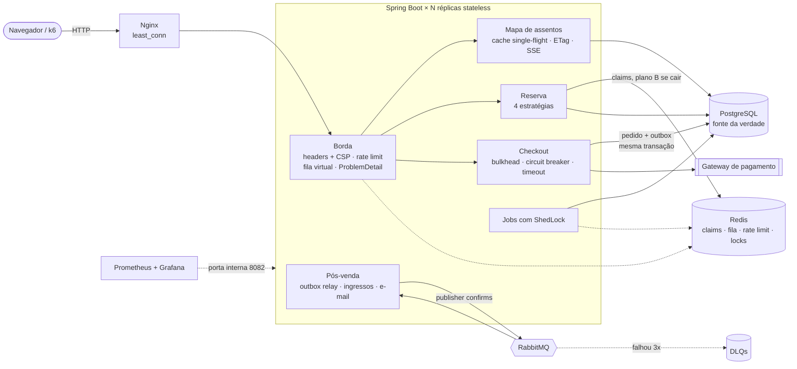
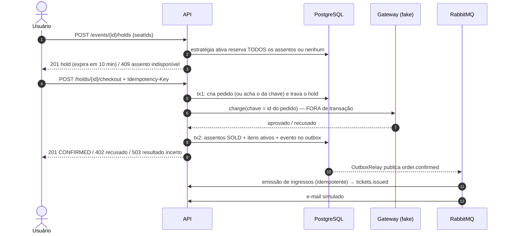

# Ticket System — venda de ingressos com alta concorrência

[](https://github.com/Thg1zZ/TicketSystem/actions/workflows/ci.yml)

API backend para a **abertura de vendas de um show**: milhares de pessoas tentando comprar os mesmos
assentos no mesmo segundo. O sistema tem duas regras inegociáveis:

1. **nunca vender o mesmo assento duas vezes;**
2. **nunca cobrar o mesmo pagamento duas vezes.**

O diferencial do projeto é **implementar quatro estratégias de controle de concorrência, trocáveis por
configuração, e compará-las com teste de carga (k6)** — com prova, via SQL, de zero vendas duplicadas.

> Java 21 · Spring Boot 4.1 · PostgreSQL 17 + Flyway · Redis 8 · RabbitMQ 4 · Testcontainers · k6 · Docker Compose
> · Prometheus + Grafana · SSE · fila virtual · testes de caos · 133 testes · 95% de cobertura de linhas · licença MIT

---

## Sumário
- [Demo visual](#demo-visual)
- [Arquitetura](#arquitetura)
- [Fluxo de compra](#fluxo-de-compra)
- [Estratégias de concorrência](#estratégias-de-concorrência)
- [Resultados do teste de carga](#resultados-do-teste-de-carga)
- [Observabilidade](#observabilidade)
- [Escalabilidade: a prova final](#escalabilidade-a-prova-final)
- [Escala horizontal](#escala-horizontal)
- [Leitura em escala: mapa de assentos](#leitura-em-escala-mapa-de-assentos)
- [Fila virtual e rate limit](#fila-virtual-e-rate-limit)
- [Resiliência e caos](#resiliência-e-caos)
- [Como as garantias são asseguradas](#como-as-garantias-são-asseguradas)
- [Segurança](#segurança)
- [Decisões técnicas](#decisões-técnicas)
- [API](#api)
- [Como rodar](#como-rodar)
- [Testes](#testes)
- [Limitações conhecidas e próximos passos](#limitações-conhecidas-e-próximos-passos)

---

## Demo visual

Com a stack no ar, abra **http://localhost:8081/** — uma página em HTML, CSS e JavaScript puros (sem framework nem
build), servida pela própria aplicação e usando só a API pública:

- **mapa de assentos** com palco e cores por estado (livre, selecionado, seu, reservado, vendido), atualizado a cada 2 s;
- **fluxo completo:** escolher até 4 assentos → reservar (contador de 10:00) → pagar (a `Idempotency-Key` é gerada e
  exibida; pagar de novo nunca cobra duas vezes) → ingressos com **QR code** emitidos via RabbitMQ → cancelar;
- **atividade da API** ao lado: cada chamada com status e mensagem (201, 409, 402…), para ver o backend reagindo;
- tema claro/escuro automático e layout para celular.

**Demonstração de concorrência:** abra duas abas (cada aba é um comprador diferente, mude o nome no topo se quiser),
selecione o mesmo assento nas duas e clique em *Reservar* nas duas. Uma ganha; a outra recebe **409** e o assento
pisca em vermelho. Criar eventos pede o token de admin (`ADMIN_TOKEN` do `.env`).

Por segurança, todo texto vindo da API entra na página via `textContent` (nunca `innerHTML`) e o token de admin não é
salvo no navegador.

## Arquitetura



Código organizado **por feature** (`event`, `reservation`, `queue`, `checkout`, `payment`, `ticketing`,
`notification`, `messaging`, `shared`), não por camada. Cada mecanismo de escala é ligável por configuração: réplicas,
fila, rate limit e observabilidade.

## Fluxo de compra



## Estratégias de concorrência

Selecionadas por `ticket.reservation.strategy` (no Docker: `STRATEGY=redis docker compose up -d`).
Todas passam pelo **mesmo contrato de testes** (`ReservationStrategyContract`): 50 threads no mesmo assento →
exatamente 1 vencedor; pedidos sobrepostos em ordem invertida → sem deadlock; hold expirado pode ser tomado;
hold liberado pode ser reservado na hora.

| Estratégia | Como funciona | A favor | Contra |
|---|---|---|---|
| `pessimistic` (padrão) | `SELECT … FOR UPDATE OF s ORDER BY id`: trava as linhas dos assentos | Simples, correto por construção | Quem chega depois **espera** segurando conexão do pool |
| `optimistic` | Lê sem lock e grava com `@Version` (`WHERE version = ?`) | Ninguém espera | Sob disputa forte, muito trabalho é desperdiçado; sem retry (o assento já tem dono) |
| `conditional` | Um único `UPDATE … WHERE status disponível` e confere as linhas afetadas | O banco faz "checar e gravar" atomicamente, 1 ida ao banco | Não diz qual assento falhou num pedido múltiplo |
| `redis` | `MGET` rejeita antes da transação quem já perdeu; script Lua tudo-ou-nada decide; o banco confirma com UPDATE condicional | Perdedores nem pegam conexão do Postgres | Mais um componente para operar; precisa de compensação se o banco der rollback |

## Resultados do teste de carga

**Cenário** ([`loadtest/seat-rush.js`](loadtest/seat-rush.js)): **5.000 compradores distintos, 1.000 ao mesmo tempo,
disputando 500 assentos** (1 setor, 20 fileiras × 25). Cada um quer 1 ou 2 assentos vizinhos sorteados; quem ganha o
hold paga (gateway fake com 50–300 ms de latência e 10% de recusa). Antes de cada medição, banco, Redis e RabbitMQ
são zerados e um aquecimento de 1.000 usuários roda num evento separado (descartado). Duas rodadas por estratégia,
medidas com o código final (depois da revisão de segurança).

**Ambiente:** Windows 10 + Docker Desktop (VM com 12 CPUs e 8 GB) — app, PostgreSQL, Redis, RabbitMQ **e o próprio k6
na mesma máquina**, com outro projeto rodando ao lado. Pool Hikari padrão (10 conexões), virtual threads ligadas.
Os números servem para **comparar estratégias**, não como capacidade absoluta.

Latência e throughput da reserva (`POST /events/{id}/holds`), medidos pelo k6 — rodada 1 / rodada 2:

| Estratégia | Duração | Throughput (holds/s) | p50 | p95 | p99 | Erros inesperados | Assentos vendidos 2× |
|---|---|---|---|---|---|---|---|
| `pessimistic` | 7,8 s / 12,8 s | 645 / 392 | 869 / 1.900 ms | 2.148 / 3.645 ms | 3.408 / 4.628 ms | **0%** | **0** |
| `optimistic` | 9,8 s / 8,4 s | 512 / 593 | 1.204 / 1.045 ms | 2.425 / 2.235 ms | 3.725 / 3.141 ms | **0%** | **0** |
| `conditional` | 16,2 s / 5,1 s | 308 / 975 | 1.822 / 571 ms | 5.187 / 1.258 ms | 7.103 / 1.994 ms | **0%** | **0** |
| `redis` | **4,4 s / 5,7 s** | **1.140 / 879** | **10 / 4 ms** | 1.999 / 2.400 ms | 2.664 / 2.830 ms | **0%** | **0** |

"Erro inesperado" = qualquer resposta fora das esperadas (201/409 no hold, 201/402 no checkout) ou timeout.

**Prova de integridade** ([`loadtest/proof.sql`](loadtest/proof.sql) + métricas do gateway) — rodada 1 / rodada 2:

| Checagem | pessimistic | optimistic | conditional | redis |
|---|---|---|---|---|
| Assento em mais de um item vendido | 0 / 0 | 0 / 0 | 0 / 0 | 0 / 0 |
| Assento `SOLD` sem item vendido (ou o contrário) | 0 / 0 | 0 / 0 | 0 / 0 | 0 / 0 |
| Pedidos duplicados para a mesma `Idempotency-Key` | 0 / 0 | 0 / 0 | 0 / 0 | 0 / 0 |
| Ingressos válidos duplicados para o mesmo assento | 0 / 0 | 0 / 0 | 0 / 0 | 0 / 0 |
| Cobranças aprovadas = pedidos confirmados | 676 = 676 / 682 = 682 | 672 = 672 / 680 = 680 | 677 = 677 / 666 = 666 | 634 = 634 / 658 = 658 |
| Eventos do outbox não publicados | 0 / 0 | 0 / 0 | 0 / 0 | 0 / 0 |
| Assentos vendidos na medição (de 500) | 490 / 482 | 487 / 489 | 491 / 488 | 458 / 456 |

(As cobranças incluem as do aquecimento, que usa um evento separado; nenhuma precisou de estorno.)

### O que os números mostram

1. **A integridade não depende da estratégia:** nas 8 medições, zero venda dupla, zero cobrança duplicada e
   zero erro inesperado — o banco (UPDATE condicional + índice único parcial) é a última barreira em todas.
2. **O gargalo não é o lock, é o pool de conexões.** Com 1.000 requisições simultâneas e 10 conexões, a latência
   das estratégias de banco é quase toda *fila por conexão*. Virtual threads aceitam as 1.000 requisições, mas não
   criam conexões.
3. **O Redis foi o único resultado estável:** maior throughput em todas as rodadas (inclusive nas medições
   anteriores à revisão de segurança, 1.191 e 1.382 holds/s) e **p50 entre 4 e 12 ms**. O motivo é a rejeição
   antecipada: os ~92% que perdem a disputa recebem 409 por um `MGET` no Redis, *antes* de abrir a transação, sem
   pegar conexão. Na primeira versão, o portão Lua rodava dentro da transação e o Redis empatava com as outras
   (≈800 holds/s, p50 ≈ 800 ms). O Lua e o `UPDATE` condicional continuam sendo o portão de verdade.
4. **Entre as três estratégias de banco não há vencedor confiável nesta máquina:** rodadas idênticas variaram mais
   do que as estratégias entre si (`conditional` foi de 308 a 975 holds/s; `pessimistic` de 645 a 392). Escolher
   entre elas exigiria mais rodadas em hardware dedicado. Em teoria, o `conditional` faz menos trabalho (um único
   `UPDATE` que checa e grava), o `optimistic` desperdiça leitura + escrita + rollback quando perde, e o
   `pessimistic` segura a conexão enquanto espera o lock.
5. **O Redis vendeu menos assentos (≈457) sem vazar nenhum.** A medição termina tão rápido que os assentos
   devolvidos por pagamentos recusados voltam quando quase todos os compradores já foram atendidos. Conferido: os
   restantes ficam `AVAILABLE`, nenhum preso em `HELD`.
6. **Próximos passos para a cauda (p95/p99):** dimensionar o pool / PgBouncer, rate limiting ou fila virtual
   (sala de espera) antes da reserva.

## Observabilidade

```bash
docker compose --profile observability up -d     # + Prometheus (127.0.0.1:9091) e Grafana (127.0.0.1:3001)
```

O painel **Ticket System** abre direto no Grafana (somente leitura sem login) e se organiza em três blocos:

| Bloco | O que mostra |
|---|---|
| **Vendas** | holds por resultado (`created`, `rejected_early` = barrado no Redis, `seat_taken` = perdeu no banco), checkout (`confirmed`, `declined`, `seats_lost`, `replayed`), cobranças no gateway, ingressos emitidos e **outbox pendente** |
| **API — método RED** (*Rate, Errors, Duration*) | req/s por rota e status, taxa de 409, **p50/p95/p99** de hold e checkout |
| **Recursos — método USE** (*Utilization, Saturation, Errors*) | pool de conexões (ativas, **esperando**, tempo de espera), heap, threads e CPU |

- **Percentis de verdade:** `http.server.requests` publica um **histograma** (buckets de 5 ms a 30 s), e o Prometheus
  calcula p95/p99 somando todas as instâncias. Média esconde a cauda, e percentil pré-calculado por instância não pode
  ser somado.
- **Cardinalidade controlada:** as tags são só valores fixos (`outcome`, rota com *template* `/events/{eventId}/holds`);
  nunca ids de usuário ou de pedido, que criariam uma série por valor.
- **Métricas fora da porta pública:** no compose, o Actuator roda na porta **8082**, que só existe dentro da rede do
  Docker. O Prometheus encontra cada réplica pelo DNS do serviço `app`. A porta 8081 expõe apenas `/livez` e
  `/readyz`, e o *readiness* depende só do banco: Redis ou RabbitMQ fora degradam funções, mas não tiram a instância
  do balanceador.

**O que o painel revelou (1 réplica).** Durante o k6, o gauge de conexões pendentes chegou a **992 threads esperando** com o pool
(10) cheio. Comparando o tempo acumulado de espera (um contador que não perde picos curtos entre dois *scrapes*):

| Estratégia | Conexões pedidas | Tempo total na fila do pool | Maior espera |
|---|---|---|---|
| pessimistic | 8.752 | 10.215 s | 7,0 s |
| redis | 5.026 (−43%) | 3.713 s (−64%) | 3,5 s |

A rejeição antecipada no Redis **reduz** a pressão, mas não elimina a saturação: a primeira onda chega antes de
qualquer assento estar tomado e todos disputam o pool. Controlar a **entrada** (fila virtual) é o próximo passo.

## Escalabilidade: a prova final

`./loadtest/matrix.sh`: réplicas {1, 3} × estratégia {`conditional`, `redis`} × fila {sem, com}, em **duas rodadas**
(numa máquina só a variação entre rodadas é grande). Cada execução tem 5.000 compradores (1.000 simultâneos) por 500
assentos, banco zerado, aquecimento descartado e a prova SQL no fim. Valores por rodada: `rodada 1 / rodada 2`.

| Estratégia | Réplicas | Fila | Holds/s | Hold p50 | Hold p99 | Checkout p99 | Retries (503) | Erros | Correção |
|---|---|---|---|---|---|---|---|---|---|
| conditional | 1 | não | 761 / 587 | 766 ms / 1233 ms | 2,2 s / 3,2 s | 3,9 s / 6,1 s | 0 / 0 | 0 / 0 | ✅ |
| conditional | 1 | sim | 98 / 98 | 5 ms / 4 ms | 0,4 s / 0,6 s | 1,0 s / 0,8 s | 0 / 0 | 0 / 0 | ✅ |
| conditional | 3 | não | 521 / 658 | 1180 ms / 949 ms | 4,3 s / 3,2 s | 7,3 s / 6,3 s | 0 / 0 | 0 / 0 | ✅ |
| conditional | 3 | sim | 98 / 98 | 5 ms / 6 ms | 0,4 s / 0,8 s | 1,4 s / 2,3 s | 0 / 0 | 0 / 0 | ✅ |
| redis | 1 | não | 569 / 544 | 4 ms / 4 ms | 2,8 s / 3,4 s | 5,6 s / 7,9 s | 4 / 9 | 0 / 0 | ✅ |
| redis | 1 | sim | 98 / 97 | 1 ms / 2 ms | 0,2 s / 0,6 s | 0,9 s / 1,9 s | 0 / 1 | 0 / 0 | ✅ |
| redis | 3 | não | 801 / 1025 | 25 ms / 49 ms | 3,6 s / 3,2 s | 5,1 s / 4,1 s | 0 / 0 | 0 / 0 | ✅ |
| redis | 3 | sim | 98 / 98 | 1 ms / 1 ms | 0,6 s / 0,7 s | 1,8 s / 1,3 s | 0 / 0 | 0 / 0 | ✅ |

*Holds/s* é o total de holds dividido pela duração do teste. Quando há *retries*, a duração inclui a espera de
`Retry-After` (5 s) desses compradores, o que derruba o número sem o servidor ter ficado mais lento (é o caso de
`redis` com 1 réplica).

"Correção" é a prova SQL inteira: nenhum assento vendido duas vezes, cobranças aprovadas = pedidos confirmados, nenhum
pedido pendente, um ingresso por assento vendido, *outbox* vazio e nenhuma réplica morta por memória.

**Leitura em massa** (`spectators.sh`, 5.000 espectadores recarregando a cada 2 s com compradores mudando o mapa):

| Réplicas | Leituras/s | 304 | p99 | Erros | Consultas ao banco |
|---|---|---|---|---|---|
| 1 | 2444 / 2401 | 56% / 39% | 79 ms / 246 ms | 0 / 0 | 120 / 118 (de 149389 / 147377 leituras) |
| 3 | 2444 / 2457 | 72% / 66% | 2 ms / 2 ms | 0 / 0 | 359 / 358 (de 150001 / 150000 leituras) |

**O que escalou**
- **Leitura.** ~150 mil leituras custaram ~120 consultas ao banco com 1 réplica e ~360 com 3 (uma recarga a cada
  0,5 s por réplica). O p99 cai de 79–246 ms com 1 réplica para 2 ms com 3: aqui sim mais réplicas ajudam, porque o
  trabalho é da aplicação (servir o cache), não do banco.
- **Latência sob pico, com a fila.** O banco recebe só a taxa de admissão (~98 holds/s), e quem entra é atendido em
  milissegundos, com 1 ou 3 réplicas, com ou sem Redis.

**O que não escalou, e por quê**
- **Vazão de escrita com mais réplicas.** Numa máquina só, 3 JVMs dividem a mesma CPU, e o portão de verdade continua
  sendo **um** Postgres com linhas disputadas. Réplicas de aplicação não multiplicam a capacidade de um banco único.
  O que mais ajudou a escrita foi tirar trabalho do banco (o filtro do Redis), não adicionar réplicas.

**O que a matriz revelou (e foi corrigido)**

A primeira versão da matriz teve erros só nas execuções com **1 réplica** (de 9 a 227 por execução), e o app não
tinha registrado nenhum. Investigar isso rendeu três correções:
- **503 do *bulkhead* de pagamento.** Com 1 réplica, mais de 100 cobranças simultâneas eram recusadas com 503,
  `Retry-After` e "nada foi cobrado". O servidor estava certo; o cliente de carga é que tratava 503 como falha
  definitiva. Agora ele repete com a mesma `Idempotency-Key`, como a API documenta (coluna *retries*).
- **504 do Nginx em execuções de 4 s.** Não era timeout de leitura: o início do rush abre centenas de conexões com a
  única réplica, a fila de aceitação do Tomcat (100 por padrão) enchia, o kernel descartava os SYNs excedentes e o
  Nginx desistia de conectar depois de 2 s. Com 3 réplicas as conexões se dividem e a fila não enche, por isso só 1
  réplica falhava. `server.tomcat.accept-count: 1024` resolveu: 0 erros em 5 execuções seguidas do cenário que falhava.
- **Réplica morta por OOM que nunca voltava.** Provocando 2.000 compradores simultâneos numa réplica de 1 GB, o
  kernel a matou por memória, e o compose não tinha política de reinício. Agora tem (`restart: unless-stopped`).

Para que o k6 mostre a causa na próxima vez, os erros inesperados saem separados por status HTTP.

**Decisões rejeitadas**

| Alternativa | Por que não |
|---|---|
| Kafka | O volume de eventos é pequeno (alguns por pedido) e o RabbitMQ com *outbox*, DLQ e consumidores idempotentes já dá entrega garantida. Kafka brilha em *streams* de alto volume com *replay*, ao custo de operar um cluster. |
| Microsserviços | Pedido, assentos e *outbox* mudam na **mesma transação**. Separar exigiria *sagas* para reproduzir o que hoje é um `COMMIT`. A aplicação já escala horizontalmente por ser *stateless*. |
| *Sharding* do Postgres | O evento seria a chave natural (toda transação toca assentos de um só evento), e as chaves do Redis já usam o evento como *hash tag* para isso. Mas um Postgres aguenta com folga a ordem de grandeza medida; antes viriam réplicas de leitura. |
| Kubernetes | O compose demonstra os mesmos conceitos: réplicas, *probes* `/livez` e `/readyz`, limites de memória e reinício. Um `Deployment` usaria exatamente esses *probes* e limites. |

## Escala horizontal

A API é *stateless*: o estado vive no Postgres (verdade), no Redis (claims, locks) e no RabbitMQ. Por isso ela sobe
com **N réplicas** (`APP_REPLICAS`, padrão 3) atrás de um **Nginx** (`least_conn`), e o que precisa ser único no
cluster tem um mecanismo próprio:

| Parte | Com N réplicas |
|---|---|
| Reserva e checkout | o portão continua sendo o banco (UPDATE condicional, `UNIQUE`), então não importa em qual réplica cai cada requisição |
| Jobs agendados | **ShedLock** no Redis: uma execução por intervalo no cluster |
| Outbox | cada réplica publica em paralelo; `FOR UPDATE SKIP LOCKED` impede que duas peguem a mesma linha |
| Consumidores RabbitMQ | a fila distribui as mensagens entre as réplicas; consumidores idempotentes |
| Migrations | o Flyway usa *advisory lock* do Postgres: 3 réplicas subindo juntas, uma migra e as outras esperam |
| Conexões | `réplicas × pool ≤ max_connections − reserva` (3 × 10 = 30 de 100) |

**Prova (1 × 3 réplicas, 5.000 usuários, 1.000 simultâneos, 500 assentos, uma máquina):**

| Estratégia | Réplicas | Holds/s | p50 | p99 | Erros | Vendas duplicadas | Cobranças = confirmados |
|---|---|---|---|---|---|---|---|
| conditional | 1 | 679 | 879 ms | 3,0 s | 0 | **0** | 683 = 683 |
| conditional | 3 | 592 | 1.160 ms | 3,3 s | 0 | **0** | 695 = 695 |
| redis | 1 | 1.483 | 14 ms | 2,0 s | 0 | **0** | 636 = 636 |
| redis | 3 | 525 | 40 ms | 5,5 s | 0 | **0** | 617 = 617 |

- **Correção:** com 3 réplicas atendendo a mesma disputa, nenhum assento vendido duas vezes, nenhum pedido ou
  ingresso duplicado e cada cobrança aprovada virou exatamente um pedido confirmado.
- **Distribuição:** as três réplicas receberam carga (54% / 25% / 21% das requisições: o `least_conn` favorece a que
  responde mais rápido) e as três emitiram ingressos pelo RabbitMQ.
- **Throughput não subiu, e isso era esperado aqui:** as 3 réplicas, o Postgres, o Redis e o k6 dividem a **mesma
  CPU e memória**. Cada réplica a mais é mais uma JVM disputando a máquina (e cada uma fica com 1/3 do aquecimento),
  e o banco continua sendo um só. Escala horizontal ganha throughput quando cada réplica tem hardware próprio e o
  gargalo não é compartilhado; o que este teste prova é que **o sistema continua correto com N instâncias**.

**Incidente encontrado no caminho.** Na primeira matriz, `conditional` com 3 réplicas desabou para 27 holds/s com 43%
de erros. O painel mostrou **pausas de GC de 8 a 14 s nas três réplicas ao mesmo tempo** com heap de só ~150 MB, e o
`/proc/pressure/memory` da VM registrou *stall* por memória. Causa: limite de 768 MB por container com heap em 75% →
sobravam ~190 MB para metaspace, code cache, pilhas e buffers; sob carga o container encostava no limite e o kernel
passava a usar swap. Correção: 1 GB por réplica, heap em 65%, **swap desligado no container** (`memswap_limit`), para
que um estouro vire OOM visível e não lentidão silenciosa. O `run-all.sh` agora registra o pico de memória e os
eventos de OOM de cada réplica (pico medido: 779 MiB com 1 réplica, acima do limite antigo).

## Leitura em escala: mapa de assentos

Numa abertura de vendas, quem **olha** o mapa é muito mais numeroso do que quem compra. Antes, cada atualização da
página eram duas consultas ao banco. Três camadas resolvem isso:

| Camada | Como funciona |
|---|---|
| **Cache de 500 ms com *single-flight*** | Todos os leitores de um evento recebem o mesmo *snapshot*; quando ele vence, **uma** requisição recarrega e as que chegam ao mesmo tempo esperam o mesmo resultado (mesmo padrão *memoizer* do gateway). Isso evita o *cache stampede*: milhares de requisições batendo no banco no instante em que o cache expira. |
| **ETag + `If-None-Match` → 304** | O ETag é um SHA-256 dos ids e estados dos assentos, então é **igual em todas as réplicas**. Nada mudou → 304 sem corpo. O mapa usa `Cache-Control: no-cache` (pode guardar, mas revalida), e o navegador manda o `If-None-Match` sozinho. |
| **SSE** (`GET /events/{id}/seats/stream`) | Um laço por réplica confere, a cada 500 ms, o mapa dos eventos que alguém está assistindo e empurra só quando o ETag mudou. O custo no banco depende de **quantos eventos** estão sendo vistos, não de quantas pessoas. A página usa `EventSource` e volta ao polling se o stream cair ou a réplica recusar (limite de 2.000 streams por réplica → 503). |

**Medição** (`loadtest/spectators.sh`, 3 réplicas): 5.000 espectadores recarregando a cada 2 s, com 20 compradores
mudando o mapa sem parar, durante 60 s:

| Leituras do mapa | 304 (sem corpo) | p50 / p95 / p99 | Erros | **Consultas ao banco** |
|---|---|---|---|---|
| 150.001 (2.445/s) | 69% | 0,3 / 1,5 / 10 ms | 0 | **357** (1 a cada 420 leituras; sem o cache seriam 300 mil) |

O teto teórico é 3 réplicas × 2 recargas/s × 61 s ≈ 366: o *single-flight* segurou o banco no limite projetado.

**Por que SSE e não WebSocket ou Redis Pub/Sub?** O mapa só vai do servidor para o cliente, e SSE é HTTP comum:
atravessa proxies, reconecta sozinho e não precisa de protocolo novo (WebSocket serve para conversa nos dois
sentidos). Redis Pub/Sub entregaria a mudança em milissegundos em vez de até 500 ms, mas exigiria publicar em cada
um dos ~8 pontos do código que mudam um assento; fica como evolução. Detalhes práticos: o heartbeat a cada 15 s
mantém a conexão viva no Nginx e também detecta clientes que sumiram (um socket fechado só é percebido quando uma
escrita falha); `X-Accel-Buffering: no` faz o Nginx repassar os eventos sem acumular.

## Fila virtual e rate limit

As fases anteriores mostraram o limite: numa abertura de vendas, mil compradores chegam no mesmo segundo e disputam
um pool de conexões. Até com o Redis barrando os perdedores, o pool satura na primeira onda. A saída é **controlar a
entrada** em vez de aguentar o pico. É o que fazem as grandes vendas de ingressos.

**Fila virtual (sala de espera)**, ligada com `QUEUE_ENABLED=true`:

| Parte | Como funciona |
|---|---|
| Entrar | `POST /events/{id}/queue`: idempotente (entrar de novo mantém o lugar). Ordem de chegada por um contador atômico (`HINCRBY`), não por relógio, então dois pedidos no mesmo milissegundo em réplicas diferentes não empatam. |
| Admitir | Um script Lua no Redis admite pelo **tempo decorrido** desde a última admissão (como um *token bucket*): quem consultar primeiro admite todos os que já têm direito. A taxa global (`QUEUE_ADMISSIONS_PER_SECOND`, padrão 100/s) fica certa com qualquer número de réplicas e sem job agendado. Usa o relógio do Redis (`TIME`), então as réplicas concordam sobre o "agora". |
| Esperar | `GET /events/{id}/queue`: posição e espera estimada; a página mostra "Você é o 1.234º da fila". |
| Passe | Admitido, o comprador recebe `base64url(evento.usuário.vencimento).HMAC-SHA256`, válido por 15 min. **Sem estado:** qualquer réplica verifica o passe de outra só com o segredo compartilhado (`QUEUE_PASS_SECRET`, 32+ bytes, sem ele a aplicação nem sobe). Comparação em tempo constante. |
| Portão | Com a fila ligada, `POST /events/{id}/holds` exige `X-Queue-Pass` daquele evento e daquele usuário; sem ele, **403**. |

**Medição** (`conditional`, 3 réplicas, 5.000 compradores, 1.000 simultâneos, mesmo rush com e sem fila):

| | Holds/s | Hold p50 | Hold p99 | Checkout p99 | Erros | Pool: threads esperando conexão |
|---|---|---|---|---|---|---|
| Sem fila | 103 | 5,9 s | 26,7 s | 38,4 s | 14 | até **538** |
| **Com fila** (100/s) | 98 | **4,6 ms** | **524 ms** | **1,8 s** | **0** | **0** (depois do 1º segundo) |

- O banco recebe um fluxo **constante** de ~100 holds/s, que é a taxa de admissão. Quem é admitido tem resposta em
  milissegundos em vez de esperar atrás de todo mundo no pool.
- Os 14 erros sem fila aconteceram **na borda**: o app não registrou nenhum 5xx, e a prova SQL mostra todas as compras
  concluídas. O checkout esperou mais que os 60 s do proxy, e o cliente desistiu sem saber que tinha comprado.
- A espera na fila ficou em ~10 s para todos (p50 10,0 s, máximo 10,6 s). É a Lei de Little: o k6 mantém ~1.000
  compradores na fila, que a 100/s levam 10 s para andar.
- Vendas duplicadas: **0** nas duas rodadas; cobranças aprovadas = pedidos confirmados.

**Rate limit** (`RATE_LIMIT_ENABLED`, ligado por padrão): *token bucket* em Lua no Redis, compartilhado pelas réplicas,
em toda escrita (POST, PUT, PATCH, DELETE), **por IP** (100, repondo 50/s: generoso, porque muita gente divide IP em
NAT e rede móvel) e **por usuário** (5, repondo 1/s). Acima do limite: **429** com `Retry-After`. O IP vem do
`X-Forwarded-For`, que o Nginx **sobrescreve**, e o Tomcat só confia nele quando a conexão vem de uma rede privada
(o proxy). Se o Redis cair, o limitador **deixa passar** e conta a falha: ele protege a capacidade, não é ele que
mantém a venda correta. Leituras não são limitadas: são baratas e vêm do cache.

## Resiliência e caos

Cada dependência pode falhar; a pergunta é o que acontece com a venda quando ela falha. A regra do projeto:
**degradar no desempenho, nunca na correção**.

| Dependência fora | Comportamento | Por que é seguro |
|---|---|---|
| **Redis** | A estratégia `redis` passa a usar só o portão do banco (UPDATE condicional); o filtro antecipado é pulado; liberar um hold continua funcionando; o rate limit **deixa passar**; a fila **não admite ninguém novo** (503), mas quem já tem o passe continua comprando (o passe é verificado sem o Redis). | O Postgres sempre foi a fonte da verdade; o Redis só acelera. Uma reivindicação que chegou ao Redis mas cuja resposta se perdeu é desfeita se a transação falhar. |
| **RabbitMQ** | O checkout confirma normalmente; o evento fica no *outbox* e os ingressos saem quando o broker volta. | O evento é gravado na mesma transação do pedido (Transactional Outbox). |
| **Gateway de pagamento** | *Timeout* de 3 s (resultado desconhecido → 503; o *retry* com a mesma chave reencontra a mesma cobrança); *bulkhead* de 100 chamadas simultâneas por réplica (`@ConcurrencyLimit` nativo do Spring 7; acima disso → 503 na hora); *circuit breaker* (Resilience4j) que abre com 50% de falhas e passa a responder 503 sem chamar o gateway. | O pedido fica pendente e a mesma `Idempotency-Key` retoma. Cartão recusado é resposta normal: não abre o circuito. |
| **Postgres** | 503 + `Retry-After`, e a réplica sai do balanceador (`/readyz` depende só do banco). | Sem o banco não dá para vender com correção: o certo é recusar e pedir para tentar de novo. |

Um detalhe que faz diferença: o Lettuce esperaria **60 s** por comando num Redis travado. Com *timeout* de 1 s e o
*circuit breaker* `redis`, só as primeiras chamadas pagam a espera; as seguintes vão direto ao plano B.

**Testes de caos** (`ChaosTest`, Toxiproxy + Testcontainers): a conexão de cada dependência passa por um proxy que o
teste corta ou deixa lento no meio do fluxo. Rodam numa stack própria, porque os outros contextos de teste
compartilham o RabbitMQ e publicariam o *outbox* deste por conta própria.

| Cenário | Verificado |
|---|---|
| Redis fora | holds continuam (201), a disputa pelo mesmo assento ainda dá 409, liberar funciona, `/readyz` 200 |
| Redis travado (latência de 5 s) | depois que o circuito abre, um hold leva menos de 500 ms |
| RabbitMQ fora | pedido confirmado, evento retido no *outbox*, ingressos emitidos quando o broker volta |
| Postgres fora | 503 + `Retry-After`, `/readyz` 503, recuperação automática quando ele volta |

**O caos achou um bug real.** Com o Postgres fora, a API respondia **500**, não 503: a consulta falhava, o *rollback*
também falhava (conexão morta), e a exceção do *rollback* substituía a original, caindo no tratamento genérico. Agora
o `ApiExceptionHandler` decide pela cadeia inteira de causas (SQLState `08`, *rollback* que falha no JDBC). O defeito
existia desde a primeira fase e nenhum teste comum o revelava.

**Caos na stack real** (`./loadtest/chaos.sh`, estratégia `redis`, 3 réplicas, 5.000 compradores): Redis derrubado
antes do rush e RabbitMQ 2 s depois; os dois religados ao final.

| Holds/s | p50 / p99 | Erros | Vendas duplicadas | Holds pelo plano B | Ingressos depois que o RabbitMQ voltou | Cobranças = confirmados |
|---|---|---|---|---|---|---|
| 209 (com Redis: ~900) | 3,0 s / 10,4 s (com Redis: ~30 ms / ~4 s) | **0** | **0** | **5.000** | 486 de 486 assentos | 667 = 667 |

O painel do Grafana ganhou uma seção de resiliência: circuitos abertos por réplica, fallbacks do Redis por operação,
429 e 503 de pagamento.

## Como as garantias são asseguradas

**Nunca vender o mesmo assento duas vezes** — defesa em camadas:
1. a **estratégia** de reserva escolhe um único dono para o assento;
2. a confirmação só vende assentos que **ainda pertencem** ao hold (`UPDATE … WHERE hold_id = ? AND status = 'HELD'`);
3. o **índice único parcial** `ux_order_item_active_seat ON order_item(seat_id) WHERE active` faz o próprio
   banco recusar uma segunda venda, mesmo que as camadas acima tenham um bug.

**Nunca cobrar duas vezes:**
1. `UNIQUE(user_id, idempotency_key)` em `orders`: repetir o checkout devolve o mesmo pedido (`Idempotent-Replayed: true`);
2. o gateway é chamado com o **id do pedido** como chave de idempotência — retries e requisições concorrentes
   reaproveitam a mesma cobrança; o job de recuperação **só consulta** o gateway, nunca cria cobrança (pedido
   abandonado antes de pagar é encerrado sem cobrar; pedido cobrado antes de uma queda é confirmado);
3. se os assentos se perdem durante um pagamento lento, a cobrança é **estornada** e o pedido vira `PAYMENT_FAILED`
   (estorno só existe para cobrança aprovada, e é idempotente).

**Nunca perder o pós-venda:** o evento vai para a tabela `outbox_event` **na mesma transação** do pedido; um relay
publica com *publisher confirms*. Entrega *at-least-once* → consumidores idempotentes
(`UNIQUE(order_id, seat_id)` em `ticket` + `INSERT … ON CONFLICT DO NOTHING`).

## Segurança

Revisão guiada por OWASP Top 10 e OWASP API Security Top 10:

| Risco | O que o projeto faz |
|---|---|
| Acesso a objeto de outro usuário (API1 / A01) | Pedidos, holds, ingressos e QR respondem **404** para quem não é o dono — nem a existência vaza. IDs públicos são UUID v4 aleatórios. |
| Função administrativa exposta (API5) | `POST /events` exige `X-Admin-Token` (comparação em tempo constante; sem token configurado, a operação fica **desligada**). |
| Fluxos de negócio sensíveis, bots e cambistas (API6) | Fila virtual com passe assinado por evento e usuário (403 sem ele) e rate limit por usuário e por IP (429 + `Retry-After`). |
| Consumo irrestrito de recursos (API4) | Corpo de requisição limitado a 64 KB (413), evento limitado a 10.000 assentos, hold limitado a 4 assentos, no máximo 2.000 streams SSE por réplica (503, e o cliente volta ao polling). |
| Injeção (A03) | Toda consulta é parametrizada (JPA, SQL nativo, JdbcTemplate, `KEYS/ARGV` no Lua). `X-User-Id` só aceita `[A-Za-z0-9_-]{1,64}` — sem markup nem sequências que forjem logs. |
| Configuração insegura (A05) | Postgres, Redis, RabbitMQ e app escutam só em `127.0.0.1`; Redis exige senha; credenciais vêm do ambiente (`.env.example`); na porta pública o Actuator expõe só `/livez` e `/readyz` (status, sem versões/disco), e as métricas ficam numa porta de gestão interna (8082) que não é publicada no host; headers `nosniff`, `X-Frame-Options: DENY`, `Referrer-Policy`, `Cache-Control: no-store` (respostas carregam códigos de ingresso) e **`Content-Security-Policy`** (só scripts e recursos da própria origem), aplicados **antes** de qualquer outro filtro, então também valem para 413 e 429. |
| Falhas de integridade de dados (A08) | Preço calculado no servidor (o cliente nunca envia valor); DTOs explícitos (sem *mass assignment*); código do ingresso com 144 bits de `SecureRandom`. |
| Componentes vulneráveis / cadeia de suprimentos (A06/A08) | Dependabot (Maven, Actions, Docker), Actions fixadas por SHA, token do CI só leitura, imagens fixadas por digest, Maven Wrapper com SHA-256. As dependências de runtime foram conferidas na base OSV: o `amqp-client` que o Boot 4.1.2 traz (5.30.0) tinha 10 CVEs, uma delas expondo a senha do broker em mensagens de exceção (que o projeto registra em log), então a versão é sobrescrita para a 5.37.0. |
| Vazamento em erros (A05/A09) | Toda resposta de erro é ProblemDetail sem stack trace nem SQL; detalhes só no log. Container roda como usuário não-root. |

**Revisão final (fases 8 a 13).** Uma nova perícia sobre o código de escala achou e corrigiu quatro problemas:
respostas de filtros (413, 429) saíam sem os headers de segurança; não havia CSP; o `amqp-client` vulnerável; e
consultar a fila de um evento qualquer criava chaves no Redis, o que permitiria encher o Redis com GETs sem login
(API4). Cada correção tem teste, e o da fila falha se a correção for removida.

## Decisões técnicas

| Decisão | Por quê |
|---|---|
| Pagamento **fora** de qualquer transação | Uma chamada lenta não pode segurar conexão do pool nem lock de linha. O checkout são 3 transações curtas, todas repetíveis. |
| Expiração **lógica** + job de limpeza | `held_until <= agora` já conta como livre em todo lugar; o job só faz faxina. Se ele parar, nada quebra. |
| Transições de status com **UPDATE condicional** | `… WHERE status = 'ACTIVE'` + contagem de linhas: entre chamadas concorrentes, exatamente uma vence, sem lock explícito. |
| Hold `CONVERTED` no início do checkout | Impede que o usuário libere (ou o job expire) o hold durante o pagamento. |
| Rejeição antecipada **fora** da transação (Redis) | Numa abertura de vendas a maioria perde; quem perde sem pegar conexão do pool deixa o banco para quem ganhou. Foi o que dobrou o throughput no k6. |
| Estratégia escolhida numa **fábrica** (`enum` + `switch`) | Valor inválido derruba o startup com mensagem clara (antes: erro obscuro de "no qualifying bean", encontrado durante o teste de carga). |
| Redis como **portão**, Postgres como **verdade** | Se o Redis perder dados, o UPDATE condicional no banco ainda barra a venda dupla (há teste que apaga a chave e prova isso). |
| `TransactionSynchronization` para compensar o Redis | Se a transação do banco der rollback, o claim no Redis é desfeito; sem isso o assento ficaria bloqueado por 10 min. |
| Chaves Redis `seat:{eventId}:seatId` | *Hash tag* mantém os assentos de um evento no mesmo slot do Redis Cluster (scripts multi-chave exigem isso). |
| **Transactional Outbox** em vez de publicar direto | Publicar após o commit perde a mensagem se a app cair no meio; o outbox não. `FOR UPDATE SKIP LOCKED` permite várias instâncias. |
| DLQ por fila + `default-requeue-rejected: false` | Mensagem venenosa não fica em loop infinito; vai para a DLQ depois de 3 tentativas com backoff. |
| Evento Spring **síncrono** para anular ingressos no cancelamento | Mesma transação (pedido cancelado nunca fica com ingresso válido) sem criar dependência circular entre pacotes. |
| Sequences `INCREMENT BY 50` em vez de IDENTITY | Permite ao Hibernate fazer *JDBC batch*: um evento de 500 assentos é criado em ~0,4 s. |
| Testcontainers com Postgres real (não H2) | Locks, índices parciais, `SKIP LOCKED` e `ON CONFLICT` são comportamentos do Postgres. |
| `Clock` injetável (`MutableClock` nos testes) | Testes de expiração "pulam" 10 minutos sem `sleep`. |
| **Nginx** com `least_conn` + `resolve` | `least_conn` manda cada requisição para a réplica com menos requisições em andamento (melhor que *round-robin* quando a latência varia muito, como numa disputa). `resolve` re-consulta o DNS do Docker, então réplicas recriadas ou escaladas entram sem reiniciar o Nginx. |
| **ShedLock** (lock no Redis) nos jobs | Com N réplicas, cada job agendado rodaria N vezes por intervalo. O lock fica preso por um intervalo inteiro (`lockAtLeastFor`), então o job roda **uma vez no cluster**; se a réplica dona cair, o lock expira (`lockAtMostFor`) e outra assume. O `OutboxRelay` fica **sem** lock de propósito: `SKIP LOCKED` já divide o trabalho entre as réplicas. |
| Pool de conexões por réplica | `réplicas × pool ≤ max_connections (100) − reserva`. Com 3 × 10 = 30 conexões ainda sobra muito, então **sem PgBouncer**. Ele passa a ser necessário com dezenas de réplicas, quando a soma dos pools passa do que o Postgres aguenta (cada conexão é um processo no servidor). |
| *Bulkhead* do Spring 7, *circuit breaker* do Resilience4j | O Spring 7 já traz `@ConcurrencyLimit` com política de rejeição, então o *bulkhead* não precisou de biblioteca. O Resilience4j entrou só para o *circuit breaker*, com métricas no Prometheus. |
| Actuator em **porta de gestão separada** | Métricas e detalhes de runtime não ficam na porta que recebe tráfego; o Prometheus lê pela rede interna. |
| ProblemDetail (RFC 9457) | Erros padronizados, sem stack trace nem SQL na resposta; 401 token de admin, 402 recusa, 409 conflito, 413 corpo grande, 422 regra de negócio, 503 + `Retry-After` quando o resultado do pagamento é incerto ou uma dependência caiu. Documentados no OpenAPI. |

## API

Documentação interativa: **http://localhost:8081/swagger-ui.html**

| Método | Rota | Descrição |
|---|---|---|
| `POST` | `/events` | Cria evento com setores (preço por setor) e layout de assentos — exige `X-Admin-Token` |
| `GET` | `/events/{id}` | Evento e setores |
| `GET` | `/events/{id}/seats` | Mapa de assentos (até ~0,5 s de atraso; `ETag`/`If-None-Match` → 304) |
| `GET` | `/events/{id}/seats/stream` | Mapa ao vivo (Server-Sent Events): evento `seats` ao conectar e a cada mudança |
| `POST` | `/events/{id}/queue` | Entra na fila virtual (idempotente): `OPEN` (fila desligada), `WAITING` ou `ADMITTED` com o passe |
| `GET` | `/events/{id}/queue` | Posição e espera estimada, ou o passe quando admitido |
| `POST` | `/events/{id}/holds` | Reserva temporária de 1 a 4 assentos (10 min); com a fila ligada, exige `X-Queue-Pass` |
| `GET` | `/holds/{id}` | Consulta a reserva (status, prazo e assentos) |
| `DELETE` | `/holds/{id}` | Libera a reserva |
| `POST` | `/holds/{id}/checkout` | Paga a reserva (header `Idempotency-Key` obrigatório) |
| `GET` | `/orders/{id}` | Consulta pedido |
| `POST` | `/orders/{id}/cancel` | Cancela pedido confirmado (antes do evento): estorno + assentos voltam à venda |
| `GET` | `/orders/{id}/tickets` | Ingressos emitidos (assíncrono) |
| `GET` | `/tickets/{id}/qr` | QR code (PNG) do ingresso |

Todas as rotas de usuário exigem o header `X-User-Id` (`[A-Za-z0-9_-]{1,64}`). Vendas (hold e checkout) fecham quando o evento começa.

## Como rodar

Pré-requisitos: **Docker** (com Compose) e, para rodar fora do Docker, **Java 21** (o Maven Wrapper baixa o Maven).

```bash
docker compose up -d --build
```

Sem `.env`, o compose usa credenciais de desenvolvimento (aceitáveis porque tudo escuta só em `127.0.0.1`).
Para outros ambientes, copie [`.env.example`](.env.example) para `.env` e troque os valores.

| Serviço | Endereço |
|---|---|
| Demo visual | http://localhost:8081/ |
| API / Swagger | http://localhost:8081/swagger-ui.html |
| Health (readiness) | http://localhost:8081/readyz (via Nginx) |
| Grafana (perfil `observability`) | http://localhost:3001 (painel abre sem login; admin com `GRAFANA_PASSWORD` do `.env`) |
| Prometheus (perfil `observability`) | http://localhost:9091 |
| RabbitMQ (painel) | http://localhost:15673 (usuário/senha do `.env`; padrão ticket / ticket) |
| PostgreSQL | localhost:5433 |
| Redis | localhost:6380 |

A API sobe com **3 réplicas** atrás do Nginx, que é a única porta publicada (8081). Para uma só:
`APP_REPLICAS=1 docker compose up -d`.

As portas fogem das padrão (5432, 6379, 8080…) para conviver com outros projetos rodando na mesma máquina.

Exemplo de compra:

```bash
# 1. cria um evento com 2 fileiras x 5 assentos (token de admin: ADMIN_TOKEN do .env; padrão local-admin-token)
curl -s -X POST localhost:8081/events -H 'X-Admin-Token: local-admin-token' -H 'Content-Type: application/json' -d '{
  "name":"Show","venue":"Arena","startsAt":"2030-01-01T20:00:00Z",
  "sectors":[{"name":"Pista","price":150,"rows":2,"seatsPerRow":5}]}'

# 2. reserva os assentos 1 e 2 (ids vêm do GET /events/{id}/seats)
curl -s -X POST localhost:8081/events/1/holds -H 'X-User-Id: ana' \
  -H 'Content-Type: application/json' -d '{"seatIds":[1,2]}'

# 3. paga (repita o comando: mesmo pedido, nenhuma cobrança nova)
curl -s -X POST localhost:8081/holds/<HOLD_ID>/checkout -H 'X-User-Id: ana' -H 'Idempotency-Key: ana-compra-001'
```

Trocar a estratégia de concorrência:

```bash
QUEUE_ENABLED=true docker compose up -d app  # liga a fila virtual (sala de espera na página)
STRATEGY=redis docker compose up -d app      # pessimistic | optimistic | conditional | redis
                                             # recria as réplicas; o Nginx reencontra os novos IPs sozinho
```

## Testes

```bash
./mvnw verify      # unitários + integração (Testcontainers sobe Postgres, Redis e RabbitMQ reais)
```

**133 testes, cobertura de 95% das linhas e 85% dos branches** (JaCoCo; relatório em `target/site/jacoco/index.html`).
O build **falha** se a cobertura cair abaixo de 90% das linhas ou 80% dos branches; no CI, o resumo aparece na
execução e o relatório completo fica como artefato.

Destaques:
- `ReservationStrategyContract` — o mesmo contrato de concorrência roda contra as 4 estratégias;
- `CheckoutConcurrencyTest` — 10 requisições simultâneas com a mesma `Idempotency-Key` → 1 pedido, 1 cobrança;
- `CheckoutPaymentFailureTest` — recusa, assento perdido durante pagamento lento (estorno), timeout do gateway (503 → retry), pedido abandonado encerrado sem cobrança, pedido cobrado antes de uma queda confirmado pelo job;
- `PostSaleFlowTest` — checkout → outbox → RabbitMQ → ingressos + QR → e-mail; reentrega idempotente; mensagem venenosa na DLQ;
- `ChaosTest` — Redis, RabbitMQ e Postgres cortados ou lentos no meio do fluxo (Toxiproxy);
- `AdmissionControlTest` — fila FIFO na taxa configurada, passe por evento e usuário (403), 429 por usuário e por IP;
- `OrderCancellationTest` — cancelamento, revenda, estorno único.

Leitura em massa do mapa contra a stack no ar (não apaga nada):

```bash
./loadtest/spectators.sh                      # 5.000 espectadores, 60 s
```

Teste de carga (apaga os dados locais deste projeto):

```bash
./loadtest/run-all.sh                         # 4 estratégias, 5.000 usuários, 1.000 simultâneos
STRATEGIES=conditional QUEUE_ENABLED=true ./loadtest/run-all.sh   # o mesmo rush passando pela fila
./loadtest/chaos.sh                           # rush com Redis e RabbitMQ derrubados no meio
./loadtest/matrix.sh                          # prova final: réplicas × estratégia × fila, 2 rodadas (~40 min)
STRATEGIES="redis" USERS=2000 VUS=500 ./loadtest/run-all.sh
```

## Limitações conhecidas e próximos passos

- **Autenticação:** `X-User-Id` é só um identificador de escopo, **não** autenticação, e o `X-Admin-Token` é um segredo compartilhado, não um controle de acesso completo. Produção: OAuth2/JWT (Spring Security resource server) com papéis.
- **Bots e cambistas:** fila e rate limit reduzem o estrago, mas sem autenticação um bot ainda pode inventar muitos `X-User-Id` (cada um precisa esperar na fila, e o limite por IP freia o volume). Autenticação real e prova de humanidade resolveriam.
- **DLQ sem ferramenta de reprocessamento:** mensagens mortas ficam visíveis no painel do RabbitMQ, mas o reenvio é manual.
- **Gateway fake em memória, por instância:** esquece cobranças ao reiniciar e, com várias réplicas, um *retry* com a mesma `Idempotency-Key` que caia em outra réplica enquanto o pedido ainda está pendente gera uma segunda cobrança **simulada** (o assento continua vendido uma vez só: quem barra é o banco). Um gateway real (Stripe, Adyen) deduplica a chave do lado dele.
- **Outbox sem retenção:** linhas publicadas não são apagadas (falta um job de limpeza).
- **E-mail pode duplicar** em reentregas (at-least-once); resolveria com tabela de envios.
- **Mapa ao vivo com até ~0,5 s de atraso** e mapa inteiro a cada mudança: para mapas muito grandes (10 mil assentos ≈ 400 KB), enviar só os assentos que mudaram; para latência menor, Redis Pub/Sub.
- **Streams SSE sem limite por cliente:** o rate limit cobre só escritas; um único cliente pode ocupar as vagas de SSE de uma réplica (os outros voltam ao polling). Resolveria um limite de streams por IP.
- **Carga medida numa máquina só:** app, banco, Redis, RabbitMQ e k6 disputam a mesma CPU — os números valem para **comparar** estratégias, não como capacidade absoluta.
